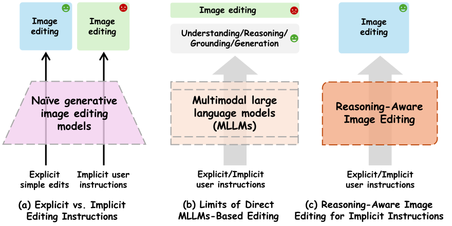
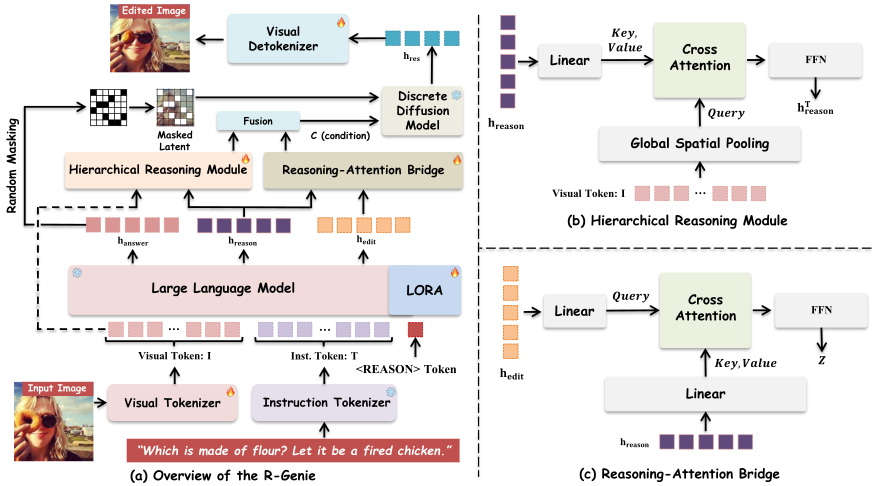
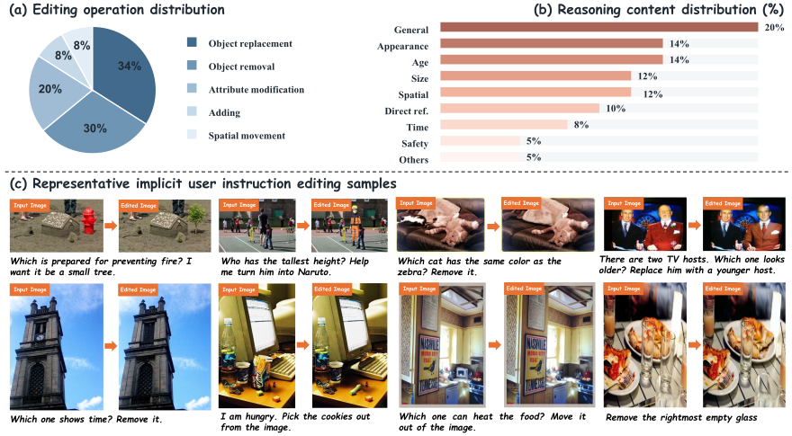
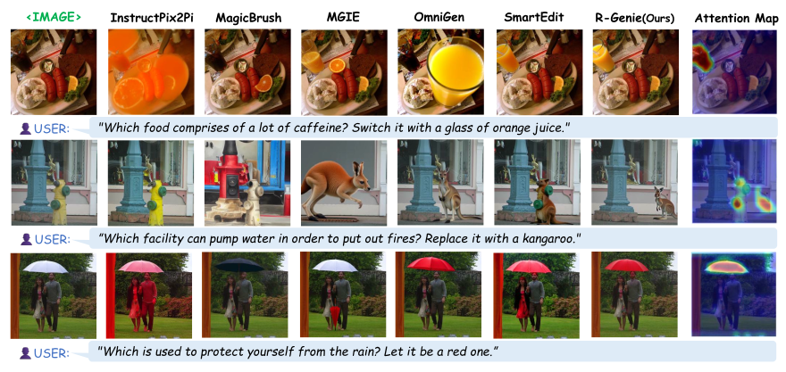
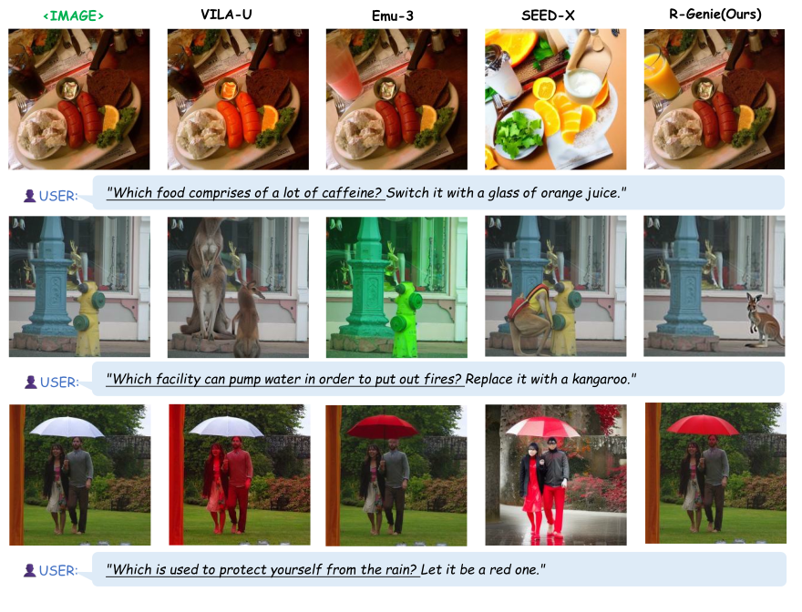
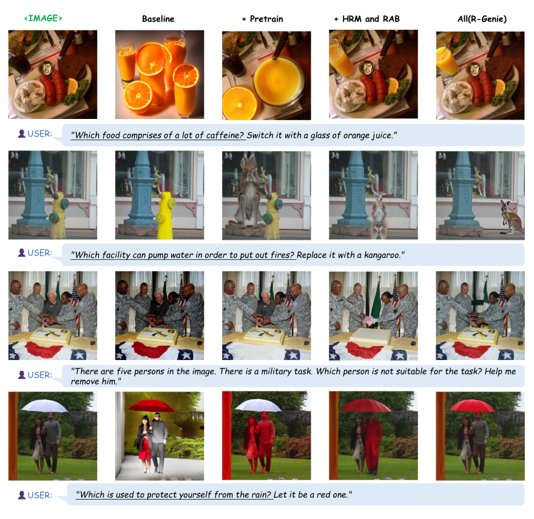

# R-Genie: Image Editing from Implicit Instructions via Latent Intention-to-Visual Conditioning

[Project Page](https://dongzhang89.github.io/RGenie.github.io/)

R-Genie is a 1.3B image editor built on Show-o for instructions that imply the target or operation. It infers the intended edit from the source image and instruction, grounds it in the relevant region, and uses that visual condition to guide discrete diffusion.



## Method Overview

1. A learned `<REASON>` token prompts the multimodal model to derive target, rationale, and edit states from the source image and instruction.
2. The Hierarchical Reasoning Module (HRM) refines these states with global visual context. The Reasoning-Attention Bridge (RAB) combines the target and edit states with local visual features and produces an attention map that initializes the inference mask.
3. The discrete denoiser uses the resulting visual condition to reconstruct masked image tokens. Inference keeps the reasoning states latent throughout.



## REditBench

REditBench contains 1,070 source-image, implicit-instruction, and target-image triples with pixel-level edit masks and annotations for editing operations and reasoning categories. The split uses 750 samples for optimization, 100 for validation, and 220 for held-out evaluation. Tasks include object replacement, removal, addition, attribute modification, and spatial movement.



## Results

### REditBench evaluation

The table shows selected baselines on the 220 held-out samples. Background L1 and L2 are computed outside the annotated edit region. The copy-input control has zero background error by construction.

| Method | CLIP Score ↑ | Background L1 ↓ | Background L2 ↓ | Aesthetic score ↑ | RISE-BS ↑ |
| --- | ---: | ---: | ---: | ---: | ---: |
| Copy input | 45.62 | 0.0000 | 0.0000 | 5.21 | 21.4 |
| SEED-X | 60.79 | 0.0769 | 0.0363 | 4.56 | 62.5 |
| SmartEdit | 60.98 | 0.0671 | 0.0245 | 4.67 | 62.7 |
| ReasonEdit-S | 58.25 | 0.0734 | 0.0362 | 3.63 | 54.9 |
| R-Genie | **62.14** | 0.0602 | 0.0201 | 4.64 | **64.0** |

R-Genie reached **85.8% reasoning target accuracy (RTA)** and **73.5% edit success accuracy (ESA)**. The RAB attention map reached **78.6% pointing accuracy** and **0.614 mask IoU** against the pixel-level masks. The region changed in the output had an IoU of **0.417**, which fell to **0.372** when the inference mask was initialized randomly.

### External benchmarks

Edit-SR measures the edit success rate on each external benchmark.

| R-Genie training setting | RISEBench Edit-SR ↑ | ReasonEdit test Edit-SR ↑ |
| --- | ---: | ---: |
| MagicBrush pretraining only | 76.9% | 80.1% |
| With REditBench fine-tuning | **80.5%** | **84.9%** |

### Latent and explicit reasoning

The REditBench comparison uses the same data, image resolution, and sampling budget. The explicit chain-of-thought (CoT) variant shares R-Genie's Phi-1.5 backbone and denoiser. Rewrite baselines use GPT-4o to make the target and operation explicit before editing.

| Conditioning | RTA ↑ | ESA ↑ | Seconds per image ↓ |
| --- | ---: | ---: | ---: |
| GPT-4o rewrite + InstructPix2Pix | 70.9% | 63.6% | 28.2 |
| GPT-4o rewrite + SmartEdit | 77.8% | 71.8% | 49.8 |
| Explicit CoT (Phi-1.5) | 82.4% | 70.8% | 16.9 |
| R-Genie (latent) | **85.8%** | **73.5%** | **14.7** |

Runtime was measured on an RTX 4090 at 512 × 512 resolution, with 10 sampling steps and batch size 2.

### Qualitative comparisons and ablation



The full model increased ESA from **66.4%** with instruction-only Show-o fine-tuning to **73.5%** with hybrid alignment, HRM, and RAB. In pairwise human evaluations, R-Genie was preferred in 189/220 comparisons with InstructPix2Pix, 157/220 with OmniGen, and 215/220 with MGIE.

<details>
<summary>Unified multimodal models and component ablations</summary>





</details>

## Repository Structure

```text
configs/
  RGenie_tuning_for_editing.yaml
docs/
  images/
  rgenie_architecture.md
models/
  RGenie.py
  rgenie_components.py
  modeling_showo.py
  modeling_magvitv2.py
  phi.py
training/
  train_edit.py
  rgenie_pipeline.py
  edit_dataset.py
  prompting_utils.py
  utils.py
```

## Data Format

Place the editing dataset under `data/`:

```text
data/
  imgs/
  gt/
  editing_instruction_dict.json
```

`imgs/` stores source images, `gt/` stores target edited images, and `editing_instruction_dict.json` maps image ids to instructions.

## Model Components

Download or prepare the following model folders:

- `hf_model/show-o`
- `hf_model/magvitv2`
- `hf_model/phi-1_5`
- `hf_model/R-Genie`

The current training entrypoint uses `configs/RGenie_tuning_for_editing.yaml` by default.

## Training

```bash
deepspeed --master_port=24999 training/train_edit.py config=./configs/RGenie_tuning_for_editing.yaml exp_name=showo-edit
```

You can also run:

```bash
bash run.sh
```

## Architecture Notes

See [docs/rgenie_architecture.md](docs/rgenie_architecture.md) for notes on the training code in this repository.
